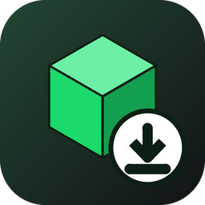
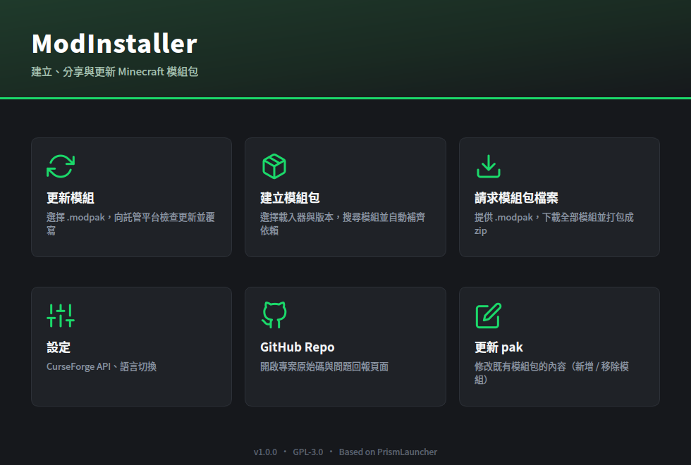
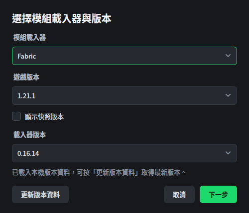
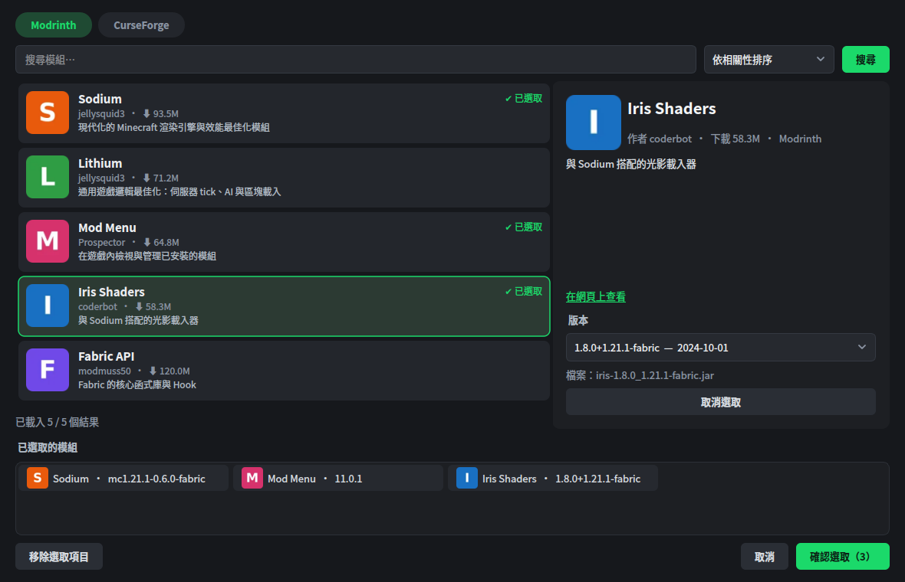
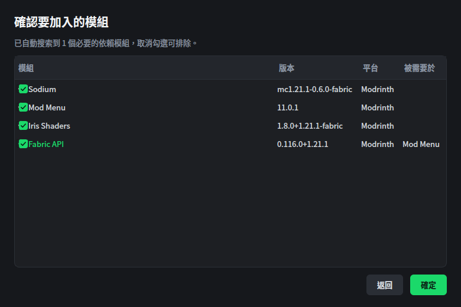
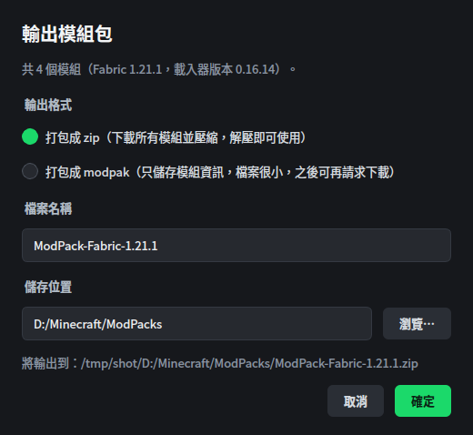
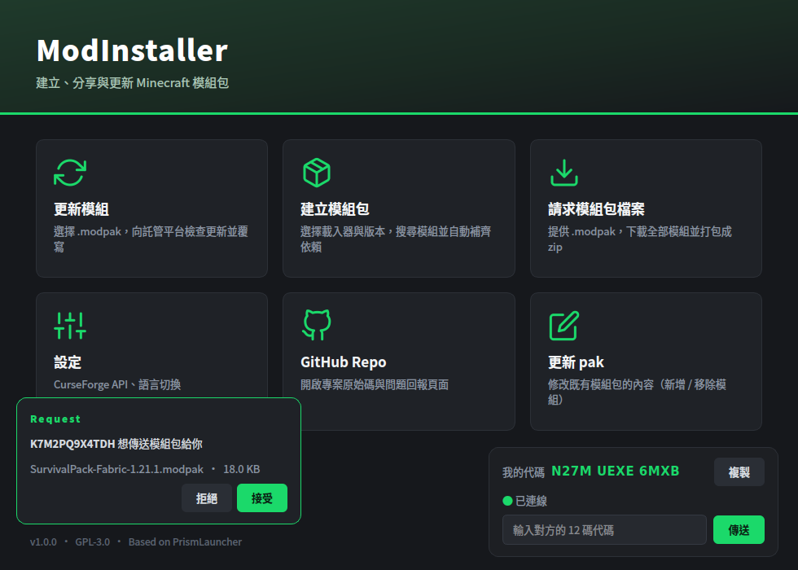

<div align="center">



# ModInstaller

**建立、分享與更新 Minecraft 模組包** — 搜尋 Modrinth / CurseForge、自動補齊依賴、一鍵輸出 zip 或超輕量的 `.modpak`


[](https://github.com/neil289506-commits/ModInstaller/actions/workflows/build.yml)



</div>

> 以下截圖使用示意資料。

## 為什麼用 ModInstaller？
- **不用啟動器**：只想整理模組清單，不需要建立遊戲實例
- **自動補齊依賴**：搜索邏輯移植自 PrismLauncher，連 Fabric API ↔ Quilted Fabric API 都會自動轉換
- **`.modpak` 輕量分享**：只存模組清單與 sha256，檔案只有幾 KB，收到的人再「請求模組包檔案」就能還原成 zip
- **雙平台來源**：Modrinth 與 CurseForge 一起搜尋
- **繁體中文 / English**

## 使用流程

### 1. 選擇載入器與版本
Fabric / Quilt / Forge / NeoForge 與遊戲版本，版本資料直接從官方來源下載，不需要 Python。



### 2. 搜尋並選取模組
左側是搜尋結果，右側是詳細資訊與版本選擇，底部是已選取清單。



### 3. 確認依賴
自動搜索到的必要依賴會列出並標示「被誰需要」，可自行取消勾選。



### 4. 輸出
選擇 **zip**（下載全部模組並壓縮）或 **modpak**（只存資訊），名稱與儲存位置都由你決定。



### 5. 傳送給朋友
右下角是你的 12 碼代碼；輸入對方的代碼按「傳送」，對方左下角會出現 **Request** 提醒，按下接受後才會開始傳輸。



## 功能
| 入口 | 說明 |
|---|---|
| 更新模組 | 選擇 `.modpak`，向各模組登記的託管平台請求更新，有更新就提示並覆寫（覆寫前備份為 `.bak`） |
| 建立模組包 | 選載入器 + 遊戲版本 + 載入器版本 → 搜尋模組（Modrinth / CurseForge）→ 自動搜索依賴 → 確認 → 輸出 zip 或 modpak |
| 請求模組包檔案 | 提供 `.modpak`，依 `mod.info` 下載、驗證 sha256，打包成 `<檔名>.zip` |
| 設定 | CurseForge API Key、語言切換（繁體中文 / English） |
| GitHub Repo | 開啟本專案頁面 |
| 模組包傳輸 | 主畫面右下角顯示本機 12 碼代碼；輸入對方代碼即可傳送 `.modpak` / `.zip`，對方左下角會出現 Request 提醒，接受後才開始傳輸（點對點，不經過伺服器） |
| 更新 pak | 開啟既有 `.modpak`，新增 / 移除模組（流程同「建立模組包」），再另存或覆寫 |

所有輸出檔案都會讓使用者輸入名稱與儲存位置。

## .modpak 格式
`.modpak` 是 zip，內含兩個 JSON 檔：
- `version.info`：名稱、Minecraft 版本、載入器與版本、每個模組的託管平台
- `mod.info`：每個模組的下載地址、版本號、版本 ID、檔名、sha256

zip 輸出格式：所有模組放在 `mods/` 資料夾內。

## 模組包傳輸
- **代碼**：每台電腦第一次開啟時隨機產生 12 碼英數代碼（不含任何硬體資訊），同時存放在使用者層級的兩個位置（Windows 登錄檔 `HKCU\Software\ModInstaller\Device` 與 `%LOCALAPPDATA%\ModInstaller\ModInstaller\device.json`），任何一處遺失都會由另一處還原。
- **不重複**：代碼會向你自己部署的 Cloudflare Worker（`cloudflare/`，D1 資料庫）註冊；若代碼已存在，客戶端會自動換新代碼重試。註冊服務網址在「設定」裡填寫。
- **流程**：傳送方的 Request 經由 PeerJS 雲端伺服器（`0.peerjs.com`）交換訊號；接收方按下「接受」之前不會回應連線（不會洩漏 IP）；接受後走 WebRTC 點對點傳輸，並驗證 sha256；拒絕或逾時會通知傳送方。
- 只允許傳送 `.modpak` / `.zip`，上限 8 GB；接收端的檔名會清理，且儲存的名稱與位置一律由你決定。
- 兩台電腦都需要開著程式並顯示「已連線」；防火牆嚴格的網路會自動使用 PeerJS 的 TURN 中繼。
- 部署註冊服務請見 [`cloudflare/README.md`](cloudflare/README.md)。

## 版本資料
不需要 Python。程式用 Qt 網路直接下載（與原 `version.py` 相同的來源）並解析到
`%LOCALAPPDATA%/ModInstaller/ModInstaller/version/`：Mojang、Fabric、Quilt、Forge（maven + promotions）、NeoForge、OptiFine。

## 建置（Windows / MSVC 2022 / Qt 6.4+）
只需要 **Qt 6** 與 **CMake 3.21+**，其他依賴由 CMake 自動處理：
- zip / modpak 讀寫使用 Qt 內建的 `QZipReader` / `QZipWriter`（需要 Qt 的 private headers，官方安裝程式預設就有）
- 模組圖示使用的 libwebp 與傳輸功能使用的 libdatachannel（WebRTC）會由 CMake 自動下載並靜態編譯
- libdatachannel 需要 **OpenSSL**（Windows 建議 `vcpkg install openssl:x64-windows-static-md`，並在 CMake 加上 vcpkg 的 toolchain 與 `-DVCPKG_TARGET_TRIPLET=x64-windows-static-md`）
```bat
cmake -S . -B build -G Ninja -DCMAKE_BUILD_TYPE=Release -DCMAKE_PREFIX_PATH=<Qt6 路徑>
cmake --build build
windeployqt --release build\ModInstaller.exe
```
Qt 需勾選元件：Widgets、Network、Svg、Linguist Tools（`Qt Linguist`）。

### 內建的 CurseForge API Key
發佈版會在建置時把 CurseForge API Key 內建進程式，使用者不需要自己申請；在「設定」填入自己的 Key 時，會優先使用使用者的 Key。
金鑰不在原始碼裡：CI 從 repo secret `curseforge_api` 取得（只有 push / 標籤建置會帶入，PR 建置不會），本機建置可用環境變數 `CURSEFORGE_API_KEY` 或 `-DMI_CURSEFORGE_API_KEY=` 帶入；沒有設定時，使用者需自行在「設定」填寫。
內建的金鑰一定可以從公開發佈的執行檔中被取出，請當作半公開的金鑰（建議使用專用帳號，必要時重新產生）。

### GitHub Actions
每次 push / PR 都會在 `windows-latest`（MSVC 2022 + Qt 6.8）編譯並上傳 `ModInstaller-windows-x64.zip` 成品。
推送 `v*` 標籤（例如 `v1.0.0`）時會自動建立 GitHub Release 並附上成品。

## 開發用環境變數
`MODINSTALLER_MODRINTH_API` / `MODINSTALLER_CURSEFORGE_API` 可把 API 指向模擬伺服器（測試用）。

## 授權
GPL-3.0，見 `LICENSE`。
